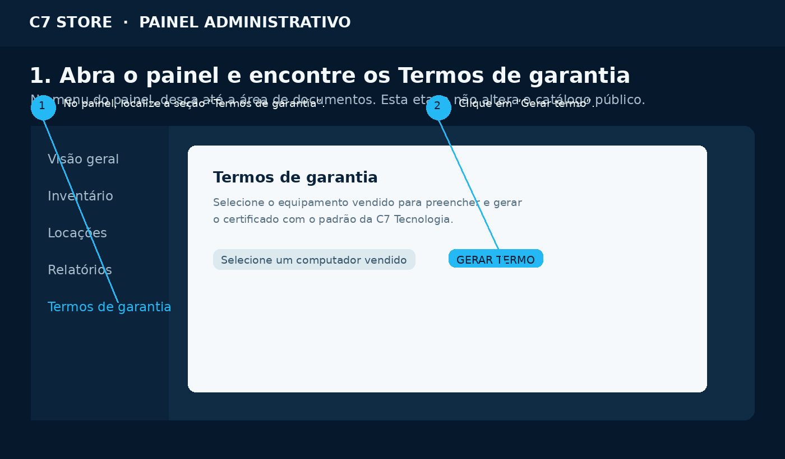
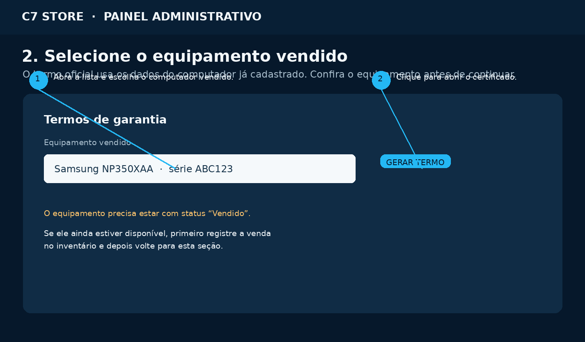
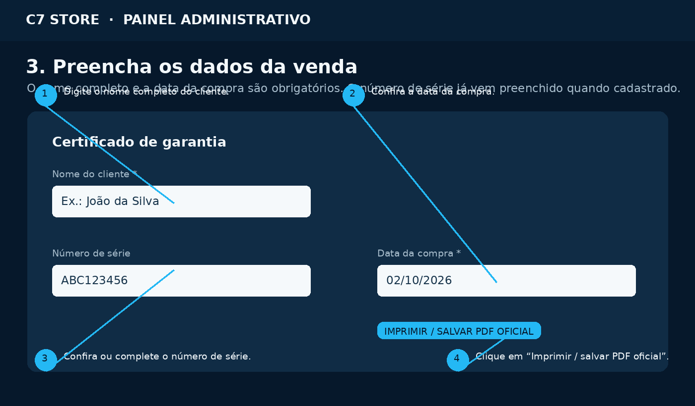
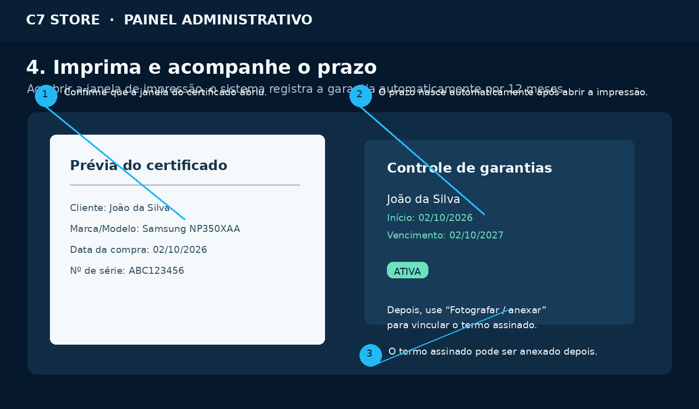
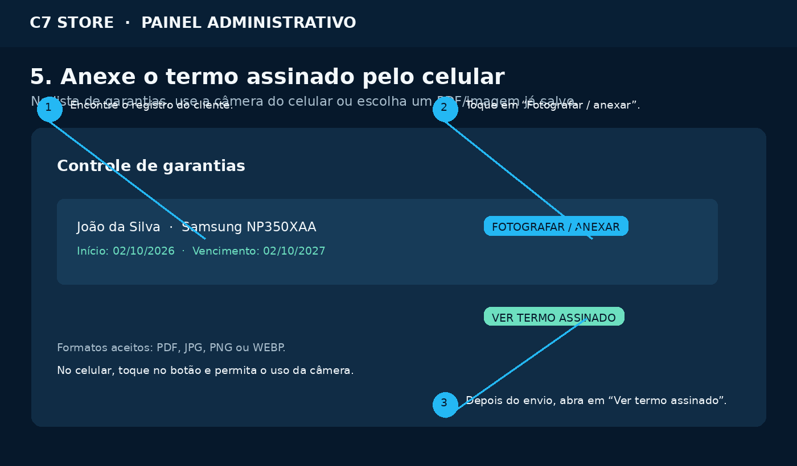

# Guia rápido — Termo de garantia

## C7 Store | C7 Tecnologia

Este guia mostra **onde clicar no painel**, **o que preencher** e como controlar a garantia depois da impressão.

> **Importante:** o termo oficial é gerado para equipamentos que já estejam marcados como **Vendido** no inventário.

---

## Fluxo em 1 minuto

1. Abra o painel administrativo.
2. Vá até **Termos de garantia**.
3. Escolha o computador vendido.
4. Clique em **Gerar termo**.
5. Preencha o **nome completo do cliente** e confirme a **data da compra**.
6. Confira o número de série.
7. Clique em **Imprimir / salvar PDF oficial**.
8. Depois de assinado, fotografe ou anexe o documento em **Controle de garantias**.

---

## 1. Encontrar a área correta

No painel administrativo, localize a seção **Termos de garantia**. Ela fica na área de documentos, depois do inventário e dos relatórios.

**Clique em:**

- **Selecione um computador vendido**; depois
- **Gerar termo**.

---

## 2. Escolher o computador

Abra a lista de equipamentos e selecione o computador que foi vendido.

Confira se aparecem corretamente:

- Marca e modelo;
- Número de série;
- Status de venda.

Se o equipamento ainda estiver como **Disponível**, primeiro registre a venda no inventário. Depois volte para **Termos de garantia**.

---

## 3. Preencher os dados do cliente

Depois de clicar em **Gerar termo**, o certificado será aberto em uma janela própria.

### Preencha estes campos

| Campo | O que informar | Obrigatório? |
|---|---|---|
| **Nome do cliente** | Nome completo de quem comprou | **Sim** |
| **Data da compra** | Dia em que a venda foi realizada | **Sim** |
| **Número de série** | Confira o número que aparece no cadastro | Recomendado |

O sistema não permite imprimir com nome vazio ou com menos de três caracteres.

---

## 4. Imprimir ou salvar em PDF

Após revisar os dados, clique em:

> **Imprimir / salvar PDF oficial**

O navegador abrirá a janela de impressão. Nela, você pode:

- Escolher uma impressora; ou
- Selecionar **Salvar como PDF**;
- Confirmar a impressão/salvamento.

### Se abrir uma página em branco

1. Verifique se o navegador permitiu pop-ups para o painel.
2. Volte ao termo e clique novamente no botão.
3. Se necessário, permita pop-ups no ícone de bloqueio ao lado do endereço do site.
4. Tente novamente usando Chrome ou Edge atualizado.

Ao abrir corretamente a janela de impressão, o sistema registra automaticamente o controle da garantia por **12 meses**.

---

## 5. Conferir o controle da garantia

Depois de imprimir, acesse a seção **Controle de garantias**.

Cada registro mostra:

- Nome do cliente;
- Equipamento;
- Data de início;
- Data de vencimento;
- Situação: **Ativa** ou **Vencida**.

A garantia começa na data da compra informada no termo e termina após 12 meses.

> Reimprimir o mesmo termo não deve criar uma nova garantia duplicada para o mesmo cliente e equipamento.

---

## 6. Anexar o termo assinado

Depois que o cliente assinar o documento, abra novamente o registro em **Controle de garantias**.

Toque ou clique em:

> **Fotografar / anexar**

Você poderá:

- Tirar uma foto usando a câmera do celular;
- Escolher uma imagem da galeria;
- Selecionar um arquivo PDF.

Formatos aceitos: **PDF, JPG, PNG e WEBP**.

Depois do envio, aparecerá o botão:

> **Ver termo assinado**

---

## Uso pelo celular

No celular, o caminho é o mesmo:

1. Abra o painel;
2. Role até **Termos de garantia**;
3. Escolha o equipamento vendido;
4. Toque em **Gerar termo**;
5. Preencha os campos;
6. Toque em **Imprimir / salvar PDF oficial**;
7. Para anexar a assinatura, use **Fotografar / anexar**.

Para fotografar melhor o documento:

- Coloque o termo em uma superfície plana;
- Use boa iluminação;
- Evite sombras sobre a assinatura;
- Enquadre as quatro bordas da página;
- Segure o celular paralelo ao documento;
- Confira a imagem antes de enviar.

---

## Checklist antes de finalizar

- [ ] O equipamento está como **Vendido**;
- [ ] O nome completo do cliente foi preenchido;
- [ ] A data da compra está correta;
- [ ] O número de série foi conferido;
- [ ] O PDF foi impresso ou salvo;
- [ ] A garantia aparece como **Ativa**;
- [ ] O termo assinado foi anexado quando disponível.

## Dúvida rápida

**Preciso anexar o termo assinado antes de imprimir?**  
Não. Primeiro gere e imprima o termo. O documento assinado pode ser anexado depois, sem alterar o prazo da garantia.

**A garantia começa quando o documento é anexado?**  
Não. Ela começa quando o termo válido é aberto para impressão, usando a data da compra informada.

**Posso cadastrar uma garantia antiga?**  
Sim. Use o botão **Adicionar garantia antiga** no Controle de garantias e informe o equipamento, cliente e data de início.

---

*C7 Store é um braço da C7 Tecnologia.*
